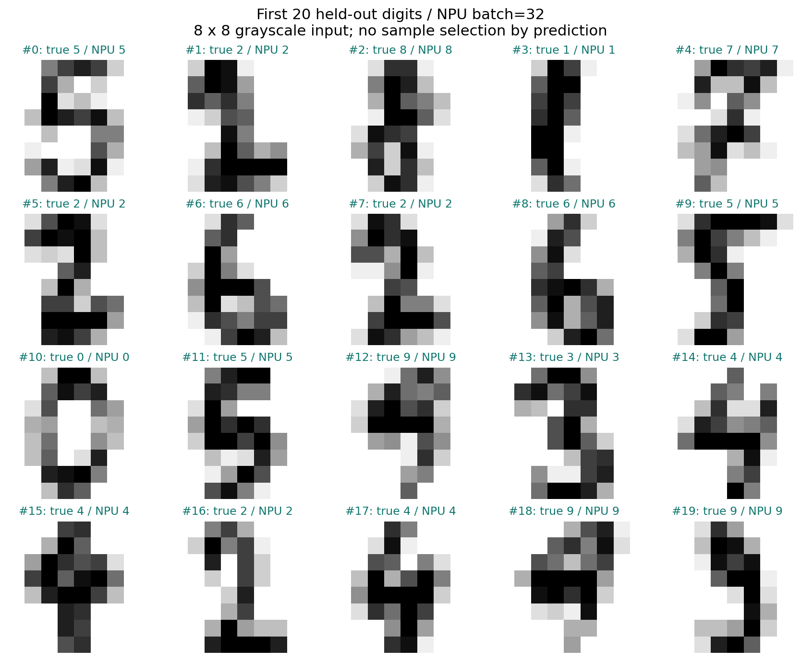
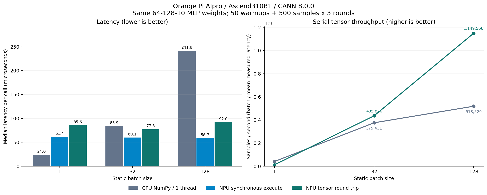

# Orange Pi AIpro 昇腾实战：从 ONNX 到 OM，验证手写数字推理与批处理性能

在 Orange Pi AIpro 上做昇腾推理开发，第一次实践可以从一个能够核对结果的小模型开始：自己训练模型，导出 ONNX，用华为 CANN 的 ATC 工具转成 OM，再通过 AscendCL Python 接口调用板上的推理能力。

这次我通过 SSH 在实际开发板上完成了整条链路，并比较了 batch=1、32、128 三种情况。三个 OM 模型在 360 个测试样本上均达到 **97.78% 准确率，预测类别与 CPU 基线 100% 一致**。性能方面，单张输入时 CPU 更快；batch=128 时，包含输入输出处理的 NPU 调用中位耗时为 **92.04 μs/批**，CPU 单线程为 **241.78 μs/批**。

本文的实践对象是**华为昇腾 CANN / AscendCL**。实验日期为 2026 年 11 月 2 日，原始日志、模型、逐样本预测和计时数据已在本地实验目录保存。公开仓库提供完整复现脚本、配图，以及移除本机路径后的汇总和计时数据；环境日志与模型文件由脚本在目标板上生成。

## 1. 先核实板端环境

通过本地 SSH 别名连接开发板：

```bash
ssh OrangePi
uname -m
cat /etc/os-release
npu-smi info
```

本次实测环境如下。

| 项目 | 实际值 |
| --- | --- |
| 开发板 | Orange Pi AIpro，主机标识为 AIpro 20T |
| CPU 架构与数量 | aarch64，4 个逻辑 CPU |
| NPU 型号 | `npu-smi` 显示 `310B1`；pyACL 返回 `Ascend310B1` |
| 系统 | Ubuntu 22.04.3 LTS |
| 内核 | Linux 5.10.0+ |
| 内存 | 系统显示约 23 GiB |
| Python | 3.10.12 |
| CANN 工具链 | 8.0.0，安装在 `/usr/local/Ascend/ascend-toolkit` |
| NumPy / scikit-learn / ONNX | 1.24.0 / 1.3.2 / 1.16.2，安装于实验虚拟环境 |
| CPU 数学库 | NumPy wheel 自带 OpenBLAS 0.3.21，armv8 |

**转换模型时，SoC 参数应来自真实设备查询。** 本机的查询命令为：

```bash
source /usr/local/Ascend/ascend-toolkit/set_env.sh
python3 -c 'import acl; print(acl.get_soc_name())'
# Ascend310B1
```

本机还存在一条需要记录的实验条件：`npu-smi` 在实验前后均显示 `Alarm`，告警码为 `80E3A203`，详细信息为电流获取异常。运行时初始化、模型加载和推理均成功。本次记录保留这一状态；功耗栏显示的 `0.0 W` 未用于能耗计算。实验也在运行桌面的非独占环境中完成，因此下文数字适用于本次软件栈和测试条件。

## 2. 建立独立实验目录和 Python 环境

板端工作目录为：

```bash
mkdir -p ~/hw/ascend310b-digits-onnx-om
cd ~/hw/ascend310b-digits-onnx-om
```

配套工程中的 `scripts/` 和 `requirements.txt` 放到该目录后，可以运行：

```bash
bash scripts/collect_env.sh
bash scripts/setup.sh
```

本机原有 Python 环境使用 NumPy 2.2.6。本次为实验单独固定了 NumPy 1.24.0、protobuf 3.20.3、SciPy 1.10.1 等版本，完整清单见 [requirements.txt](requirements.txt)。安装结束后，`pip check` 返回 `No broken requirements found`，实验结束时全局 NumPy 仍为 2.2.6。

实际操作时还遇到一个系统镜像常见问题：`python3 -m venv .venv` 提示 `ensurepip is not available`。这里采用 PyPA 提供的 virtualenv zipapp 引导环境，相关方式见 [virtualenv 官方安装说明](https://virtualenv.pypa.io/en/latest/how-to/install.html)。核心命令如下：

```bash
mkdir -p tools
curl -fL https://bootstrap.pypa.io/virtualenv.pyz -o tools/virtualenv.pyz
python3 tools/virtualenv.pyz --no-periodic-update .venv
.venv/bin/python -m pip install -r requirements.txt
.venv/bin/python -m pip check
```

配套 `setup.sh` 已包含这一回退流程，并保存下载文件的 SHA256。后续执行模型脚本前，加载工具链和虚拟环境：

```bash
source /usr/local/Ascend/ascend-toolkit/set_env.sh
source .venv/bin/activate
export OMP_NUM_THREADS=1 OPENBLAS_NUM_THREADS=1
```

## 3. 训练一个可以验证正确性的数字分类模型

数据使用 scikit-learn 随包提供的 `load_digits`。它包含 1797 张 8×8 灰度手写数字图像，每张图展开为 64 维向量，像素值范围为 0–16。这里直接除以 16 进行归一化。[数据集说明](https://scikit-learn.org/stable/modules/generated/sklearn.datasets.load_digits.html)

模型结构为：

```text
64 维输入 → 全连接 128 → ReLU → 全连接 10 → logits
```

模型共有 9610 个参数。训练和测试采用分层划分，比例约为 8:2，固定随机种子 42：1437 条训练样本、360 条测试样本。训练代码的核心部分如下，完整实现见 [train_export.py](scripts/train_export.py)。

```python
digits = load_digits()
x = np.ascontiguousarray(digits.data / 16.0, dtype=np.float32)
y = digits.target.astype(np.int64)

train_idx, test_idx = train_test_split(
    np.arange(len(y)), test_size=0.2,
    random_state=42, stratify=y,
)
classifier = MLPClassifier(
    hidden_layer_sizes=(128,), activation="relu", solver="lbfgs",
    alpha=1e-4, max_iter=300, tol=1e-6, random_state=42,
)
with threadpool_limits(limits=1):
    classifier.fit(x[train_idx], y[train_idx])

w1 = classifier.coefs_[0].astype(np.float32)
b1 = classifier.intercepts_[0].astype(np.float32)
w2 = classifier.coefs_[1].astype(np.float32)
b2 = classifier.intercepts_[1].astype(np.float32)
```

本次训练耗时约 **2.89 秒**，完成 183 次迭代。CPU 分类结果为 **352/360，准确率 97.78%**。这是此次固定划分上的结果，评价范围为该 8×8 数字数据集。

### 把同一组权重导出为三个静态 ONNX

为了控制比较条件，三个 batch 使用同一组训练权重，只改变输入、输出的第一维。网络由五个常见 ONNX 节点组成：

```python
nodes = [
    helper.make_node("MatMul", ["input", "w1"], ["mm1"]),
    helper.make_node("Add", ["mm1", "b1"], ["hidden"]),
    helper.make_node("Relu", ["hidden"], ["relu"]),
    helper.make_node("MatMul", ["relu", "w2"], ["mm2"]),
    helper.make_node("Add", ["mm2", "b2"], ["logits"]),
]

# batch 分别取 1、32、128；weights 为上一步得到的四个 FP32 数组。
graph = helper.make_graph(
    nodes, "digits_mlp_64_128_10",
    [helper.make_tensor_value_info("input", TensorProto.FLOAT, [batch, 64])],
    [helper.make_tensor_value_info("logits", TensorProto.FLOAT, [batch, 10])],
    [numpy_helper.from_array(value, name) for name, value in weights.items()],
)
model = helper.make_model(
    graph, opset_imports=[helper.make_opsetid("", 13)], ir_version=8,
)
onnx.checker.check_model(model)
onnx.save(model, f"models/digits_b{batch}.onnx")
```

输出保留为 logits，使用 `argmax` 得到类别。实际导出脚本还做了两层检查：NumPy FP32 参考计算与 scikit-learn 的预测类别完全一致；ONNX `ReferenceEvaluator` 与 NumPy 在每个 batch 的核对输入上最大绝对误差均为 0。

运行完整训练与导出：

```bash
python scripts/train_export.py
```

训练元数据写入 `results/training.json`，测试输入、标签和参考 logits 写入 `models/test_data.npz`。

## 4. 用 ATC 将 ONNX 转换为 OM

本次使用 ATC 的 ONNX 转换路径：`--framework=5`，输出可由 AscendCL 加载的 `.om` 文件。官方转换流程可参考 [Building a Model](https://www.hiascend.com/document/detail/en/canncommercial/850/appdevg/acldevg/aclcppdevg_000027.html)；本文命令已在板端 CANN 8.0.0 上执行验证。

```bash
SOC_VERSION=$(python -c 'import acl; print(acl.get_soc_name())')

for batch in 1 32 128; do
  atc --framework=5 \
    --model="models/digits_b${batch}.onnx" \
    --output="models/digits_b${batch}" \
    --soc_version="$SOC_VERSION" \
    --input_format=ND \
    --input_shape="input:${batch},64" \
    --precision_mode=allow_fp32_to_fp16 \
    --log=error
done
```

输入是 `[batch,64]` 的二维特征，因此这里使用 `ND` 格式。三个模型均输出 `ATC run success`：

| 静态 batch | 本次转换耗时 | 生成 OM 大小 |
| --- | ---: | ---: |
| 1 | 78.16 秒 | 59748 字节 |
| 32 | 71.05 秒 | 59594 字节 |
| 128 | 70.06 秒 | 59734 字节 |

转换耗时包含编译过程，本机缓存状态可能影响重跑结果。配套命令 `bash scripts/convert.sh` 会额外记录耗时、进程内存高水位和模型 SHA256。系统未安装 `/usr/bin/time`，因此脚本采用 Python 标准库 `subprocess`、`time` 和 `resource` 完成记录。

**FP32 输入输出与内部计算精度需要分别理解。** 本次 OM 的接口仍为 FP32，但显式采用 `allow_fp32_to_fp16` 策略；矩阵类算子可以使用 FP16，矢量类算子按该模式的规则选取精度。下文保留了与 CPU FP32 参考的误差数据。[官方精度模式说明](https://www.hiascend.com/document/detail/zh/canncommercial/80RC3/devaids/devtools/aoe/aoerc_16_0056.html)

## 5. 用 pyACL 加载模型并推理

本次主要调用流程如下：

```text
acl.init
  → set_device / create_context
  → mdl.load_from_file / get_desc
  → 申请并复用输入输出内存、创建 dataset
  → 写入输入 → mdl.execute → 读取输出
  → 销毁 buffer/dataset、卸载模型、释放 context
  → reset_device / finalize
```

完整封装见 [benchmark.py 中的 AclModel](scripts/benchmark.py)。这里有三个值得单独说明的细节。

### 读取 OM 描述，核对输入输出大小

模型加载后，通过描述信息确认输入输出数量、数据类型、维度和字节数。本例只有一个 FP32 输入、一个 FP32 输出：

```python
input_size = acl.mdl.get_input_size_by_index(desc, 0)
output_size = acl.mdl.get_output_size_by_index(desc, 0)
assert input_size == batch * 64 * 4
assert output_size == batch * 10 * 4
```

例如 batch=32 时，输入缓冲区是 8192 字节，输出缓冲区是 1280 字节。缓冲区在模型初始化时申请，后续推理持续复用。

### 正确处理板端 ACL_DEVICE 模式

本机 `acl.rt.get_run_mode()` 实际返回 `(0, 0)`：第一个值 `0` 是 `ACL_DEVICE`，第二个值 `0` 是成功返回码。官方将板端运行归为这一模式。[get_run_mode 接口说明](https://www.hiascend.com/doc_center/source/en/canncommercial/800/apiref/appdevgapi/aclpythondevg_01_0065.html)

输入复制时按模式选择复制方向，并保持 Python bytes 对象存活到同步复制结束：

```python
run_mode, ret = acl.rt.get_run_mode()
check(ret, "get_run_mode")

input_bytes = x.tobytes(order="C")
ptr = acl.util.bytes_to_ptr(input_bytes)
kind = 3 if run_mode == 0 else 1  # DEVICE_TO_DEVICE / HOST_TO_DEVICE
check(acl.rt.memcpy(input_ptr, input_size, ptr, len(input_bytes), kind), "memcpy")
```

本机的设备输出缓冲区可由板端 CPU 访问，代码使用 `ptr_to_bytes` 读取；配套封装同时为 `ACL_HOST` 分支提供了复制回 host 的路径。此次实际验证的模式为 `ACL_DEVICE`。指针转换时的对象生命周期要求见 [bytes_to_ptr 官方说明](https://www.hiascend.com/document/detail/zh/Atlas200IDKA2DeveloperKit/23.0.RC2/Application%20Development%20Guide/aadgp/aclpythondevg_01_0052.html)。

### 使用同步接口，计时边界清晰

```python
check(acl.mdl.execute(model_id, input_dataset, output_dataset), "execute")
```

`acl.mdl.execute` 等待本次推理完成后返回，因此本例可以直接在调用前后计时。该时间仍包含 Python 接口、运行时调度和同步等待的成本，文中将它称为“同步执行调用耗时”。[execute 接口说明](https://www.hiascend.com/doc_center/source/en/CANNCommunityEdition/910/API/ascendgraphapi/aclpythondevg_01_0145.html)

配套工程提供一个单样本入口：

```bash
python scripts/infer_once.py --batch 32 --index 0
```

实际输出的关键字段为：

```json
{
  "test_index": 0,
  "label": 5,
  "npu_prediction": 5,
  "run_mode": 0
}
```

该入口把一个样本放进静态批次的第一行，其余行补零，只读取有效样本的预测结果。

## 6. 在全部测试样本上验证转换结果

每个 OM 都遍历相同的 360 条测试数据。最后一个不足静态 batch 的批次补零，统计准确率时只计入有效行。结果如下：

| 推理路径 | 正确数 / 测试数 | 准确率 | 与 NumPy FP32 预测类别一致率 |
| --- | --- | ---: | ---: |
| CPU：scikit-learn 原模型 | 352 / 360 | 97.78% | 100% |
| CPU：NumPy FP32 参考 | 352 / 360 | 97.78% | 100% |
| OM：batch=1 | 352 / 360 | 97.78% | 100% |
| OM：batch=32 | 352 / 360 | 97.78% | 100% |
| OM：batch=128 | 352 / 360 | 97.78% | 100% |

三个 OM 的数值误差统计也一致：logits 最大绝对误差为 **0.0366211**，平均绝对误差为 **0.00613357**，相对 L2 误差约为 **0.00037134**。本次计算精度变化保留了全部测试样本的分类决策。

下图按测试集既定顺序展示前 20 条输入和 batch=32 的 NPU 预测。



完整的逐样本 logits、预测类别和真实标签保存在 `results/predictions_b1.npz`、`predictions_b32.npz`、`predictions_b128.npz` 中，便于重新核对准确率与误差。

## 7. 批处理到底改变了什么

### 测量方法

CPU 参考路径直接计算同一模型的 FP32 前向传播：

```python
np.maximum(x @ w1 + b1, 0) @ w2 + b2
```

每个 batch 测试四种路径：NumPy 线程池上限为 1、线程池上限为 4、NPU 同步执行调用、NPU 张量往返调用。线程池配置通过 `threadpoolctl` 设置并保存，库是否为某个小矩阵实际启用全部线程由其实现决定。

NPU 同步执行路径在输入已经写入、输出缓冲区已经分配的情况下计时；NPU 张量往返路径包含 `ndarray → bytes → 输入复制 → execute → 输出读取 → ndarray`。本机运行于板端 Device 模式，这里的复制没有跨 PCIe 主机传输。

所有路径都以预先准备好的内存输入为起点。CPU 路径包含产生输出数组的前向计算，NPU 两种路径分别采用上述计时范围；模型加载、训练、文件读取、图像解码、归一化、分类 `argmax` 和请求排队均在范围之外。CPU 使用 FP32，OM 使用前述精度策略，因此比较结果对应这两条具体部署路径。

每个场景每轮预热 50 次，再记录 500 次，执行 3 轮；每轮以固定种子打乱四个场景的先后顺序。最终每个场景有 1500 条记录，共 **18000 条原始延迟样本**。

```bash
python scripts/benchmark.py --warmup 50 --repeats 500 --rounds 3
```

### 延迟结果

下表单位均为 **μs/批**，每个单元格依次为“中位数 / P95”。

| batch | CPU 1 线程 | CPU 上限 4 线程 | NPU 同步执行调用 | NPU 张量往返调用 |
| --- | ---: | ---: | ---: | ---: |
| 1 | 24.02 / 24.52 | 23.98 / 24.54 | 61.36 / 68.59 | 85.64 / 103.78 |
| 32 | 83.88 / 86.05 | 83.21 / 85.71 | 60.14 / 64.00 | 77.25 / 89.21 |
| 128 | 241.78 / 271.97 | 31987.14 / 49803.90 | 58.71 / 62.21 | 92.04 / 106.51 |

batch=1 时，CPU 单线程处理一个输入约需 24.02 μs，NPU 张量往返调用约需 85.64 μs。这个 9610 参数的小网络，单个样本的计算量较小，调用和输入输出处理会明显影响总耗时。

batch=32 时，两条完整张量路径的中位耗时已经接近；NPU 的 P95 仍略高于 CPU。batch=128 时，NPU 张量往返调用中位耗时为 92.04 μs，CPU 单线程为 241.78 μs，按这一指标计算的比值约为 **2.63 倍**。

同一进程中第一个 OM 的加载调用耗时为 166.76 ms，后续两个为 8.87 ms 和 9.18 ms。这些数值受加载顺序与初始化状态影响，未用于比较不同 batch 的加载性能，也未计入上表的稳定运行延迟。

### 按平均调用耗时换算的串行处理速率

换算公式为 `batch × 1,000,000 / 平均耗时(μs)`：

| batch | CPU 1 线程，样本/秒 | NPU 张量往返，样本/秒 | NPU 平均批耗时 |
| --- | ---: | ---: | ---: |
| 1 | 40899 | 12062 | 82.91 μs |
| 32 | 375431 | 435826 | 73.42 μs |
| 128 | 518529 | 1149566 | 111.35 μs |

这里使用平均值换算，并保留异常慢调用的影响。比如 batch=128 的 NPU 平均耗时高于中位数，用平均值计算的速率约为 **115 万样本/秒**。该速率是这段串行张量调用的换算结果，服务端 QPS 还需要计入实际请求组织、预处理、后处理与等待时间。

下面的图使用单线程 CPU 作为比较基线；四线程异常的复核见下一节。



批处理的收益来自一次调用处理更多样本。batch=128 平均批耗时 111.35 μs，摊到每个样本约为 0.87 μs；单个在线请求仍需等待对应批次完成，并可能额外等待凑批。实际选择 batch 时，需要把吞吐和请求延迟一起考虑。

## 8. 一个值得保留的异常：线程增加，CPU 反而变慢

主测试中，batch=128 的四线程 NumPy 中位耗时约为 31.99 ms，明显高于单线程的 0.242 ms。我为此启动了独立进程，按“1、4、1、4”线程上限交替复核，每段预热 20 次、记录 100 次：

| 独立复核顺序 | 线程上限 | 中位耗时 |
| --- | ---: | ---: |
| 1 | 1 | 241.31 μs |
| 2 | 4 | 11977.22 μs |
| 3 | 1 | 244.75 μs |
| 4 | 4 | 11958.49 μs |

四线程明显变慢的现象得到复现，但与主测试的绝对耗时存在差异。此次未完成底层性能剖析，具体原因尚未定位，结论范围限定为本机这套 OpenBLAS、矩阵形状和运行条件。主文对比 NPU 时采用较快的单线程 CPU 基线，完整四线程数据也一并保留。

复核脚本为 [cpu_thread_check.py](scripts/cpu_thread_check.py)，输出保存在 `results/cpu-thread-check.json`。这个现象说明，部署前测量线程配置很有价值，线程数量本身不足以判断小矩阵计算性能。

## 9. 如何完整复现与核对

配套工程运行后的主要文件如下。其中 `models/`、`results/`、`logs/` 在目标板运行时生成，公开仓库中的 `measurements/` 保存本次脱敏后的汇总结果和数值计时记录。

```text
ascend310b-digits-onnx-om/
├── blog.md                       # 本文
├── requirements.txt
├── measurements/                 # 公开的脱敏汇总与原始数值计时记录
├── scripts/
│   ├── setup.sh / collect_env.sh
│   ├── train_export.py            # 训练、ONNX 导出及参考计算验证
│   ├── convert.sh / time_command.py
│   ├── benchmark.py / infer_once.py
│   ├── cpu_thread_check.py
│   └── verify_artifacts.py        # 回收材料交叉核对
├── models/                       # ONNX、OM、权重、测试输入
├── results/                      # 汇总、原始计时 CSV、逐样本输出、SHA256
├── logs/                         # 环境、安装、编译和推理日志
└── assets/                       # 两张由实测结果生成的配图
```

在已配置好 CANN 的目标板上，使用新的实验目录保存配套脚本与依赖清单，然后执行：

```bash
bash scripts/collect_env.sh
bash scripts/setup.sh
bash scripts/run.sh
```

`run.sh` 会依次训练、导出、转换、校验与计时。现有目录重跑会更新相应输出，保留原始实验时应先复制目录。OM 应根据目标 SoC 和工具链重新生成；本次保存的 OM 对应 Ascend310B1 / CANN 8.0.0。

本次回收材料还经过交叉核对：六个 ONNX/OM 的 SHA256 与记录相符；三个 batch 的逐样本输出均为 360×10；原始 CSV 的 12 组、18000 条记录可重新计算得到 JSON 中的中位数、P95 和均值。本地核对结果保存在 `results/artifact-verification.json`；公开的数值记录与汇总位于 `measurements/`，其说明文件列出了发布范围。

这次实践说明，Orange Pi AIpro 上预装的 CANN 工具链可以支持这个小型分类网络完成 **训练权重 → ONNX → OM → pyACL 推理 → 正确性验证** 的闭环。对开发者来说，先拿到一份可核对的输出，再确定计时范围、batch 和线程配置，就能更有依据地判断模型迁移后的实际收益。

**关键词：** 华为昇腾、CANN、AscendCL、pyACL、ATC、Orange Pi AIpro、ONNX、OM、边缘推理、批处理。
