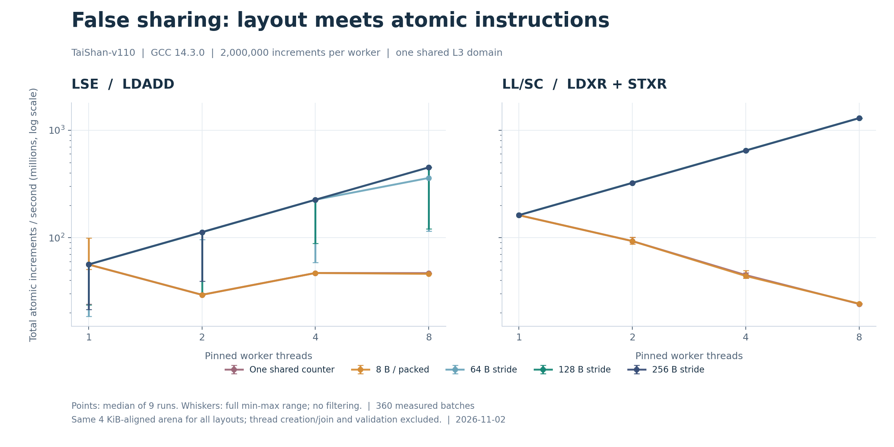

# 线程越多反而越慢？鲲鹏服务器上的伪共享与缓存行填充实测

给每个线程分配一个独立计数器，应该就没有争用了吧？如果这些计数器在内存中挤在一起，答案可能出乎意料。

我在一台真实的鲲鹏 TaiShan-v110 服务器上，比较了五种计数器布局，以及 LSE 和 LL/SC 两种 AArch64 原子实现。LL/SC 模式下，紧凑布局的总吞吐从单线程约 162 Mops/s，降到八线程约 24 Mops/s；把计数器分开后，八线程达到约 1296 Mops/s。

同为八线程，128 字节间距相对紧凑布局的加速比约为 **53.17 倍**。这是高频原子计数器微基准中的布局对照，不代表应用整体可以获得相同比例的提升。

实验源码、原始数据和复现步骤已公开到 [合集中的项目目录](https://github.com/huskyhao/huawei-computing-practice/tree/main/kunpeng-false-sharing-lab)。本文同时保留 LSE 的慢批次和加长复核结果，看看哪些结论成立，哪些还不能确定。

## 一、不同变量，为什么仍会互相影响

考虑如下计数器数组，每个线程只修改自己的元素：

```cpp
std::atomic<std::uint64_t> counters[8];

// 每个工作线程执行相同次数，tid 各不相同。
for (std::uint64_t i = 0; i < iterations; ++i)
    counters[tid].fetch_add(1, std::memory_order_relaxed);
```

从 C++ 对象角度看，八个线程操作不同的变量；从缓存布局看，八个 8 字节计数器只占 64 字节，可以落在同一缓存行中。不同核心的写入仍可能在缓存一致性层面互相影响，这就是伪共享需要关注的情形。[Linux 内核的伪共享文档](https://kernel.org/doc/html/latest/kernel-hacking/false-sharing.html)也将共享缓存行中的写入作为常见性能问题，并提醒优化时权衡空间开销。

这里的 `memory_order_relaxed` 保留原子性，只放松排序要求，不能消除硬件一致性成本。相关语义可参见 [C++ atomics.order 工作草案](https://eel.is/c++draft/atomics.order)。本实验在所有工作线程 `join` 后才读取和汇总计数。

## 二、测试环境：先确认本机缓存拓扑

实验实际执行日期为 **2026-11-02，Asia/Shanghai**。

| 项目 | 实测环境 |
|---|---|
| CPU | HiSilicon TaiShan-v110，AArch64 |
| 拓扑 | 双路、96 核、每核 1 线程、4 个 NUMA 节点 |
| 系统 | NixOS 26.05，Linux 6.12.111 |
| 编译器 | GCC 14.3.0，C++17 |
| 工作线程 | CPU 4–11，分别测试 1、2、4、8 个线程 |
| 控制线程 | CPU 12，不占用工作线程的核心 |
| 测试核心的 L1D | 64 KiB，报告的缓存行大小为 64 B |
| 测试核心的 L2 | 私有 512 KiB，报告的缓存行大小为 64 B |
| 测试核心的 L3 | 48 MiB，CPU 0–23 共享，报告的缓存行大小为 128 B |

这些数据来自 `lscpu` 和 sysfs，记录在 [environment.json](measurements/environment.json)。本次把工作线程放在同一 L3 域，避免把跨 NUMA 的额外因素混进来。

鲲鹏社区的 [CacheLine 优化文档](https://www.hikunpeng.com/document/detail/zh/perftuning/tuningtip/kunpengtuning_12_0052.html)介绍了填充和对齐，并指出鲲鹏 920 L3 CacheLine 为 128 字节。实际程序仍应同时检查各级缓存和自己的访问模式，不能由一个 L3 字段直接推导所有原子实现都必须间隔 128 字节。

## 三、实验矩阵：布局与原子指令分别对照

### 五种布局

所有布局共用同一个原子加法内核：

```cpp
extern "C" void increment_counter(
    std::atomic<std::uint64_t> *counter,
    std::uint64_t iterations) {
    for (std::uint64_t i = 0; i < iterations; ++i)
        counter->fetch_add(1, std::memory_order_relaxed);
}
```

区别仅在每个线程拿到哪个计数器地址：

| 布局 | 线程 0–3 的相对字节偏移 | 含义 |
|---|---|---|
| `shared` | 0、0、0、0 | 所有线程更新同一个原子对象，作为真共享对照 |
| `packed8` | 0、8、16、24 | 不同对象紧挨在一起 |
| `stride64` | 0、64、128、192 | 每个计数器相隔 64 字节 |
| `stride128` | 0、128、256、384 | 每个计数器相隔 128 字节 |
| `stride256` | 0、256、512、768 | 更大的间距对照 |

所有布局在同一进程中复用一块 **4 KiB 对齐、大小为 4 KiB 的独立存储**，基地址不随布局变化；每批重新构造并清零原子对象。这样避免分配大小、地址对齐与分配器元数据位置成为额外变量。

正式测试前，单线程中位吞吐的检查也很关键：LL/SC 五种布局约为 162.11–162.24 Mops/s，LSE 约为 56.34–56.41 Mops/s。它们的单线程中位基线基本一致；LSE 个别批次的波动另在后文说明。

### 同一源码，明确生成两种原子实现

公共编译选项包括：

```text
-std=c++17 -O3 -mtune=tsv110 -mno-outline-atomics -fno-lto -pthread
```

LSE 模式增加 `-march=armv8.2-a`；LL/SC 模式增加 `-march=armv8-a`。关闭 outlining，是为了让这里的指令对照明确，不在运行时通过辅助函数自动选择实现，相关选项见 [GCC AArch64 文档](https://gcc.gnu.org/onlinedocs/gcc-14.3.0/gcc/AArch64-Options.html)。

保存的 LSE 热点循环包含：

```asm
ldadd   x3, x4, [x0]
add     x2, x2, 1
cmp     x1, x2
bne     .L3
```

LL/SC 热点则包含：

```asm
ldxr    x3, [x0]
add     x3, x3, 1
stxr    w4, x3, [x0]
cbnz    w4, .L10
```

后者在独占存储失败时重试。本实验没有给重试次数插桩，因此汇编只能证明“存在重试路径”，不能直接告诉我们某一批重试了多少次。

## 四、计时与正确性如何控制

主实验对每个工作线程执行 **200 万次**原子加。每轮随机打乱五种布局与四种线程数的全部 20 个组合，连续执行 9 轮；LSE 和 LL/SC 分别运行，总计 **360 条正式记录**。

线程创建、绑核、计数器初始化和首次读取都在计时外完成。所有线程通过屏障后，各自用 `CLOCK_MONOTONIC_RAW` 记录内核开始与结束时间。批次耗时定义为：

```text
批次耗时 = 最晚一个线程的结束时间 - 最早一个线程的开始时间
总吞吐 Mops/s = 全部线程的原子加次数 / 批次秒数 / 1,000,000
```

这个时间包含工作线程起跑时间差，但不包含线程创建、`join` 和结果校验。每个线程的计时记录自身也相隔 256 字节，避免记录区再次形成紧凑热点。原始 CSV 同时保存起跑偏差和每个线程的最短/最长耗时。

程序通过编译期与运行期检查确认 64 位原子是 lock-free。每个二进制先检查 0、1、31 次迭代下的五种布局与四种线程数，共 60 种边界组合。主程序和两种模式的 UBSan 插桩程序均通过检查，正式计时使用未插桩二进制。

每个批次结束后，程序逐个检查计数器的最终值，并验证线程开始和结束时的 CPU 编号。没有按快慢剔除样本。以下吞吐为每种组合 9 批的中位数，范围和完整记录都保留在仓库中。

## 五、主实验结果

### LSE：分离计数器能提高吞吐，但部分布局出现慢批次

单位均为 **Mops/s，即所有工作线程合计的百万次原子加/秒**。

| 线程数 | 共享单计数器 | 间距 8 B | 间距 64 B | 间距 128 B | 间距 256 B |
|---:|---:|---:|---:|---:|---:|
| 1 | 56.37 | 56.40 | 56.34 | 56.41 | 56.35 |
| 2 | 29.45 | 29.45 | 112.82 | 112.44 | 112.76 |
| 4 | 46.99 | 46.99 | 225.70 | 225.47 | 225.63 |
| 8 | 46.88 | 46.14 | 359.79 | 451.02 | 451.47 |

八线程下，紧凑布局为 46.14 Mops/s，128 字节间距的中位值为 451.02 Mops/s，约为前者的 **9.78 倍**。

但只看中位数会漏掉重要信息：八线程 `stride64` 的范围为 114.89–451.65 Mops/s，`stride128` 为 120.95–451.68 Mops/s。虽然二者中位数不同，范围却大幅重叠，不能据此宣称 128 字节必然稳定胜过 64 字节。

### LL/SC：紧凑布局随着线程增加而退化

| 线程数 | 共享单计数器 | 间距 8 B | 间距 64 B | 间距 128 B | 间距 256 B |
|---:|---:|---:|---:|---:|---:|
| 1 | 162.17 | 162.11 | 162.21 | 162.24 | 162.15 |
| 2 | 93.16 | 93.09 | 323.83 | 324.26 | 323.61 |
| 4 | 44.96 | 44.07 | 648.31 | 648.25 | 646.82 |
| 8 | 24.22 | 24.38 | 1296.59 | 1296.41 | 1296.62 |

`packed8` 从单线程的 162.11 Mops/s 降到八线程的 24.38 Mops/s。线程各写各的对象，仍然无法获得扩展性。

分开后，64、128、256 字节间距在八线程下均达到约 1296 Mops/s，约为各自单线程的八倍。以 `stride128` 对比同为八线程的 `packed8`，中位吞吐加速 **53.17 倍**；八线程 `stride128` 的全部九批范围为 1289.42–1298.33 Mops/s。

这组结果说明，本次 LL/SC 内核中，64 字节间距已经获得与 128、256 字节接近的效果。填充确实解决了这个访问模式下的大部分布局瓶颈，但继续增加间距没有明显额外收益。



图使用对数纵轴，以便同时观察数十与上千 Mops/s 的曲线。点是中位值，误差线是所有九批的最小到最大值，两个面板使用相同刻度。部分曲线因结果接近而重叠。

## 六、把每批工作量增至四倍，结论是否保持

针对 LSE 的波动，我又复用**完全相同的两份二进制**，把每线程迭代数改为 800 万次，执行 3 个新的随机轮次，新增 120 条记录。没有更换内核或挑选更快的编译版本。

下面列出这组复核的八线程结果：

| 原子实现 | 布局 | 中位吞吐 Mops/s | 最小–最大 Mops/s |
|---|---|---:|---:|
| LSE | `shared` | 46.85 | 46.84–46.88 |
| LSE | `packed8` | 46.19 | 46.18–46.21 |
| LSE | `stride64` | 194.77 | 137.45–451.30 |
| LSE | `stride128` | 451.19 | 180.80–451.23 |
| LSE | `stride256` | 216.89 | 133.73–451.33 |
| LLSC | `shared` | 24.43 | 24.33–24.47 |
| LLSC | `packed8` | 24.34 | 24.32–24.55 |
| LLSC | `stride64` | 1296.22 | 1295.86–1297.59 |
| LLSC | `stride128` | 1296.78 | 1293.81–1297.33 |
| LLSC | `stride256` | 1297.75 | 1297.02–1297.93 |

LL/SC 中，紧凑布局仍在 24 Mops/s 左右，分离布局仍在 1296 Mops/s 左右，主实验判断得到支持。

LSE 的填充布局仍有明显波动，连主实验中比较稳定的 `stride256` 也出现了慢批次。因此，不能把波动简单归因于“主实验批次太短”，也不能给 64、128、256 字节间距排出一个普遍稳定的优劣顺序。

起跑偏差只有微秒量级，而相关批次耗时为数十至数百毫秒；从已记录的数据看，单纯的线程起跑时间差不足以解释这些差异。但本次没有 PMU/SPE、频率轨迹或更细的缓存状态证据，具体来源还未定位。这里把它作为实验限制公开保留。

## 七、怎样把布局优化用到实际代码

如果性能热点确实来自频繁更新的每线程统计槽位，可以显式定义对齐后的对象，例如：

```cpp
struct alignas(128) CounterSlot {
    std::atomic<std::uint64_t> value{0};
};
static_assert(sizeof(CounterSlot) == 128);

CounterSlot counters[8];
```

在这个例子里，每个对象的起始地址和数组步长都满足要求。仅仅对数组起始地址使用 `alignas(128)`，不会把原来 8 字节的数组元素自动拉开到 128 字节。

代价也很直接：计数器的有效数据只有 8 字节，槽位扩大后会增加真实业务的内存与缓存占用。本微基准为了控制变量，所有布局固定保留同样的 4 KiB 空间；它并未评估大规模填充数组的容量代价。

如果业务只需要阶段性汇总，也可以考虑线程本地累加、减少共享写入频率，再在适当的时机聚合。若要求实时读取严格的全局计数，则需要单独评估语义，不能把本实验最终汇总的模式直接替换过去。

另一个发现是，**LSE 与 LL/SC 的性能关系依赖争用形态**：本次八线程共享或紧凑场景中，LSE 吞吐高于 LL/SC；分离场景中，LL/SC 吞吐更高。这不意味着应当根据单一微基准全局禁用 LSE，真实应用还需要核对自己的原子操作、编译选项和端到端效果。

## 八、复现与证据文件

仓库保留了主实验的 `measurements/raw-lse.csv`、`raw-llsc.csv`，以及加长复核的 `validation/raw-*.csv`，合计 **480 条**未筛选记录。合并视图、表格、源文件 SHA-256、汇编、UBSan 日志和白名单环境记录也一并公开。

只复算数据，不需要服务器：

```bash
python scripts/analyze.py
python scripts/verify_artifacts.py
```

在支持 LSE 的 AArch64 Linux 上准备 GCC 与 Python 后，将源码和脚本复制到新目录，再运行：

```bash
CPUS=4,5,6,7,8,9,10,11 CONTROLLER=12 bash scripts/run.sh
bash scripts/validate_longer.sh
```

CPU 编号要根据当前进程的允许列表与缓存拓扑选择；修改后，两个脚本应传入一致配置。已有原始结果时脚本会停止，详细命令见 [README](README.md)。本次主计时区间约为 35 秒，加长复核约为 49 秒，均包含相应程序自检和预热，不含此前编译及独立 UBSan 检查。

这次实践最有用的判断是：对象彼此独立，不等于它们的写入在硬件上彼此独立。热点统计结构值得检查实际内存布局；至于选择多少字节、采用哪种原子路径，则应让本机测量与业务负载共同决定。本文没有锁定 CPU 频率，没有跨 NUMA 或应用端到端实验，也没有计数一致性流量和 LL/SC 重试，因此结果的适用范围就是当前机器上的这个高频计数器内核。
