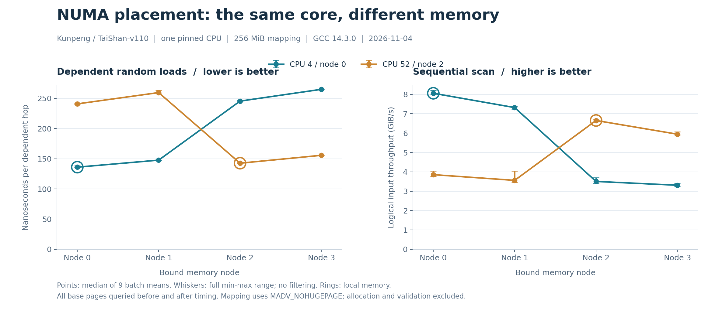

# 鲲鹏 NUMA 本地与远端内存实测

**[技术博客正文](blog.md)** · **[完整结果](measurements/table.md)** · **[官方参考资料](sources.md)** · **[公开版说明](PUBLICATION.md)**

2026-11-04，在真实 HiSilicon TaiShan-v110 / NixOS 26.05 / GCC 14.3.0 上完成单核 NUMA 实验。固定 CPU 4（节点 0）或 CPU 52（节点 2），分别绑定四个内存节点，对比依赖随机读取与顺序扫描。

CPU 4 上，本地节点 0 为 136.03 ns/跳、8.06 GiB/s；远端节点 2 为 245.43 ns/跳、3.50 GiB/s。CPU 52 的反向对照也显示本地更快。完整范围、访问内核与限制见正文。



主实验保留 144 条批次记录。每组配置前后查询全部 65,536 个 4 KiB 页面，16 次查询均确认页面全部位于指定内存节点，记录在 `measurements/placement.csv`。

## 复核已有结果

不需要鲲鹏硬件，只需 Python 3.10 或更高版本：

```bash
git clone https://github.com/huskyhao/huawei-computing-practice.git
cd huawei-computing-practice/kunpeng-numa-locality
python scripts/analyze.py
python scripts/verify_artifacts.py
```

绘图额外需要 Matplotlib：

```bash
python scripts/make_figure.py
```

## 在同类服务器重新实测

需要 AArch64 Linux、支持 `-mtune=tsv110` 的 GCC、Python 3.10+ 和 `numactl`；本次 numactl 为 2.0.18。所有辅助 Python 脚本只依赖标准库，正式计时不依赖 Python 的运行速度。

先核对允许的 CPU、内存节点及拓扑：

```bash
lscpu
numactl --hardware
grep -E 'Cpus_allowed_list|Mems_allowed_list' /proc/self/status
```

本实验矩阵固定使用 CPU 4、52 与内存节点 0–3；其他拓扑需先修改并核对 `scripts/run.py`、环境采集和分析中的矩阵，而非直接套用节点编号。`Mems_allowed_list` 仅表示 cpuset 允许范围，不是页面实际分布的证明。

复制源码和脚本到新目录，保留本次证据：

```bash
mkdir -p ../kunpeng-numa-locality-rerun
cp -r src scripts ../kunpeng-numa-locality-rerun/
cd ../kunpeng-numa-locality-rerun
bash scripts/run.sh
```

`ROUNDS=9 MIB=256` 是本次配置，可通过环境变量调整。已有原始记录时脚本停止，避免覆盖。NixOS 用户需先将准备好的 GCC、Python 和 numactl 加入当前 shell PATH；公开文件不依赖任何机器专用 Nix store 路径。

程序对测试映射使用 `MADV_NOHUGEPAGE`，每次只有一个单核子进程；主工作区 256 MiB，另有约 8 MiB 的初始化置换数组与少量校验数据。不会修改系统 NUMA balancing、THP 或频率策略。`move_pages` 以 `nodes=NULL, flags=0` 查询自身页面，不请求迁移；若权限或页面状态不满足要求，实验会停止。

## 文件说明

- `src/kernels.c`：同一份顺序求和与依赖索引追逐内核，分别编译并关闭 LTO。
- `src/bench.c`：构造完整随机单环、校验、全页节点查询、预热、校准与计时。
- `scripts/run.py`：固定种子打乱八组 CPU/内存配置，串行执行，保留各进程原始输出。
- `measurements/raw.csv`：144 条完整批次记录。
- `measurements/placement.csv`：16 条全页位置查询汇总。
- `measurements/job-*.stdout.txt`、`stderr.txt`：每组原始记录和检查日志。
- `measurements/environment.json`：白名单采集的环境、节点距离、CPU 与缓存拓扑。
- `measurements/kernels.s`：本次 GCC 生成的内核汇编。
- `measurements/source-sha256.txt`：服务器实测源码与运行脚本身份。
- `assets/numa-latency-throughput.png`：正文配图，发布博客时一并上传。

`verify_artifacts.py` 验证完整交付，包括正文与配图；复制源码重跑后，可先用 `analyze.py` 复算数值。
