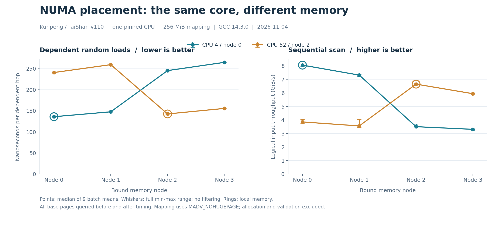

# 只绑 CPU 还不够：鲲鹏服务器本地与远端 NUMA 内存实测

把程序固定到一个 CPU 核心之后，访问的内存就一定在本地吗？在 NUMA 服务器上，CPU 位置与内存位置是两个需要分别检查的条件。

我在真实的鲲鹏 TaiShan-v110 服务器上，固定两个不同节点的 CPU，分别把同一份 256 MiB 数据放到四个内存节点，对比依赖随机读取与顺序扫描。CPU 4 不变时，内存从本地节点 0 改到远端节点 2，依赖读取从约 **136 ns/跳升到 245 ns/跳**，顺序扫描从 **8.06 GiB/s 降到 3.50 GiB/s**。

这次还逐页核查了内存位置：每组计时前后，全部 65,536 个 4 KiB 页面都查询到指定节点，避免只凭绑核命令就认定数据在本地。

实验源码、全部原始记录和复现步骤已整理到 [GitHub 合集的 NUMA 实验目录](https://github.com/huskyhao/huawei-computing-practice/tree/main/kunpeng-numa-locality)。

## 一、先分清两个位置

在 Linux 上，线程的 CPU 亲和性决定它可以在哪些 CPU 上运行，内存策略则影响页面从哪些 NUMA 节点分配。二者需要分别设置和验证。

例如，线程先在一个节点初始化数据，随后运行位置改变，已经分配的页仍可能留在原处。[Linux 内核 NUMA Memory Policy 文档](https://docs.kernel.org/admin-guide/mm/numa_memory_policy.html)也说明，安装任务内存策略不会自动搬迁此前已经分配的页面。

鲲鹏社区的 [NUMA 优化文档](https://www.hikunpeng.com/document/detail/zh/perftuning/tuningtip/kunpengtuning_12_0014.html)介绍了不同 NUMA 位置的访存差异，以及 CPU 亲和性设置方法。本篇把 CPU 和内存位置显式组合起来，检查它们对两个具体访问内核的影响。

## 二、本机拓扑与实验矩阵

实验日期：**2026 年 11 月 4 日，Asia/Shanghai**。

| 项目 | 本次环境 |
|---|---|
| CPU | HiSilicon TaiShan-v110，AArch64 |
| 拓扑 | 双路、96 核、每核 1 线程、4 个 NUMA 节点 |
| 系统 | NixOS 26.05，Linux 6.12.111 |
| 编译器 | GCC 14.3.0，C11 |
| numactl | 2.0.18 |
| 工作集 | 256 MiB 匿名映射，每组仅一个 CPU 工作 |
| 基础页 | 本机 4 KiB，测试映射显式要求不使用透明大页 |
| 本地 L3 域 | 每域 48 MiB，工作集大于单个本地 L3 域 |

节点关系来自本机 `lscpu` 和 sysfs，记录如下。socket 分组只表示哪些节点属于同一组，不是机器身份。

| NUMA 节点 | CPU 列表 | socket 分组 | 到节点 0、1、2、3 的 distance |
|---:|---|---:|---|
| 0 | 0–23 | 0 | 10、16、32、33 |
| 1 | 24–47 | 0 | 16、10、25、32 |
| 2 | 48–71 | 1 | 32、25、10、16 |
| 3 | 72–95 | 1 | 33、32、16、10 |

我选择 CPU 4（节点 0）和 CPU 52（节点 2），分别访问四个内存节点，形成 **2 个 CPU × 4 个内存节点 = 8 组配置**。两边都测一次，可以检查本地更快的现象是否只出现在某一个节点。

查看同类机器可以先执行：

```bash
lscpu
numactl --hardware
grep -E 'Cpus_allowed_list|Mems_allowed_list' /proc/self/status
```

其中 `Mems_allowed_list` 表示 cpuset 允许使用的节点范围，不是当前工作集实际落在哪些节点的证据。

## 三、两种访问方式，观察两类成本

### 依赖随机读取：下一次地址依赖上一次结果

把 256 MiB 映射划分为 128 字节槽位，共 2,097,152 个槽位。每个槽位的第一个 64 位整数保存下一个槽位编号，其余内容初始化为 1。

用固定种子打乱所有槽位后，将其连接为一个完整单环。访问内核为：

```c
uint64_t chase_cycle(const uint64_t *data, size_t steps) {
    uint64_t index = 0;
    for (size_t i = 0; i < steps; ++i)
        index = data[index * 16];
    return index;
}
```

这里保存的是索引，不是实际地址。每次读取之后才能知道下一次地址，形成一条依赖链；完整走一圈会访问全部槽位，再回到起点。正式计时前还用位图验证没有重复、遗漏或提前形成短环。

GCC 生成的关键指令包括：

```asm
lsl     x0, x0, 7
ldr     x0, [x3, x0]
```

本次用“总耗时 / 依赖读取次数”报告 ns/跳。这个数包含地址计算、循环、TLB 和缓存层次成本，**不能直接称为纯 DRAM 延迟**。

### 顺序扫描：读取同一块数据并求和

另一内核顺序读取映射中的全部 64 位元素：

```c
uint64_t scan_sum(const uint64_t *data, size_t words) {
    uint64_t sum = 0;
    for (size_t i = 0; i < words; ++i)
        sum += data[i];
    return sum;
}
```

索引部分是 0 到槽位数减一的一个排列，其余元素为 1，所以可以事先算出期望总和。每个计时批次结束后都核对结果，防止计算被当作无用代码消除。

两个内核单独编译后链接，关闭 LTO，所有节点使用同一份二进制。关键选项为：

```text
-O3 -march=armv8-a -mtune=tsv110 -fno-lto
```

顺序循环生成了 SIMD 累加；本次不切换向量化实现，只观察数据位置变化。报告的 GiB/s 为逻辑输入字节数除以时间，不等同于整机内存带宽峰值。

## 四、绑定只是开始，还要查实际页面

每组测试由独立子进程启动。CPU 4、本地节点 0 的命令形式如下：

```bash
numactl --physcpubind=4 --membind=0 build/bench 4 0 9 256
```

改为 CPU 4 访问节点 2：

```bash
numactl --physcpubind=4 --membind=2 build/bench 4 2 9 256
```

`--physcpubind` 和 `--membind` 的语义可参见 [numactl 项目手册](https://github.com/numactl/numactl/blob/master/numactl.8)。匿名映射及初始化都发生在绑定之后，程序对自己的映射使用 `MADV_NOHUGEPAGE`，让页大小条件保持一致；没有修改系统全局 THP 或 NUMA balancing 设置。

程序随后通过 `move_pages` 查询**自身映射的每一个基础页**。调用时使用 `pid=0`、`nodes=NULL`、`flags=0`，只查询当前节点，不请求页面迁移，语义见 [move_pages(2)](https://man7.org/linux/man-pages/man2/move_pages.2.html)。

每组计时前后各查一次。八组配置的 16 次查询全部通过：每次 65,536 个页均落在目标节点。例如 CPU 4、内存节点 2 的记录显示：

```text
phase   pages  page_size  node0  node1  node2  node3
before  65536  4096       0      0      65536  0
after   65536  4096       0      0      65536  0
```

程序也检查进程只允许在指定 CPU 运行，并记录每个计时批次的起止 CPU。页面查询若失败、落到其他节点或 CPU 检查不满足条件，实验会停止，不把未经验证的配置写成成功结果。

## 五、计时范围与原始样本

八组配置按固定种子打乱执行顺序，每组包含九轮正式测量；每轮随机安排“依赖读取”和“顺序扫描”的先后顺序，共得到：

```text
8 组 CPU/内存配置 × 2 种访问方式 × 9 轮 = 144 条正式批次记录
```

数组分配、完整初始化、构造随机环、结果校验与页面查询都在正式批次计时之外。每个访问内核先预热，并自动确定批次重复次数，目标约为 0.15 秒；若完整走一圈本身已超过目标，则至少执行一圈。

正式计时使用 `CLOCK_MONOTONIC_RAW`。每批前再执行一次不计时的完整访问，正式循环消费返回值，在停止计时后核对累加校验和。

独立的 1 MiB 工作集 UBSan 检查也已通过，用于验证小规模构造、访问和页查询路径，不参与下面的性能结果。正式程序则对每组 256 MiB 工作集做完整单环与总和校验。

表中给出九个批次均值的中位数，以及全部九批的最小到最大值；没有删除慢样本，也没有把这些范围称作单次访问延迟分位数。

## 六、结果：本地与远端差异有多大

| 运行 CPU（节点） | 内存节点 | distance | 依赖读取 ns/跳 | 范围 ns/跳 | 顺序读取 GiB/s | 范围 GiB/s |
|---|---:|---:|---:|---:|---:|---:|
| 4（0） | 0 | 10 | 136.03 | 135.82–138.09 | 8.06 | 7.98–8.22 |
| 4（0） | 1 | 16 | 147.66 | 147.53–147.90 | 7.32 | 7.22–7.37 |
| 4（0） | 2 | 32 | 245.43 | 245.28–246.79 | 3.50 | 3.42–3.70 |
| 4（0） | 3 | 33 | 264.97 | 264.64–265.18 | 3.31 | 3.24–3.42 |
| 52（2） | 0 | 32 | 240.84 | 240.56–241.36 | 3.85 | 3.75–4.04 |
| 52（2） | 1 | 25 | 259.55 | 259.05–263.47 | 3.56 | 3.45–4.04 |
| 52（2） | 2 | 10 | 142.59 | 142.37–144.14 | 6.65 | 6.58–6.70 |
| 52（2） | 3 | 16 | 155.68 | 155.40–155.74 | 5.94 | 5.91–6.06 |



图中的圆环表示内存位于该 CPU 的本地节点，误差线保留九批的完整范围。

### 固定 CPU 4，只改变内存位置

节点 0 为本地内存，依赖读取中位耗时为 136.03 ns/跳；节点 2 为另一个 socket 上的内存，升到 245.43 ns/跳，约为本地的 **1.80 倍**。

顺序读取则从 8.06 GiB/s 降到 3.50 GiB/s，本地吞吐约为远端的 **2.30 倍**。相同的计算代码和固定的 CPU，仍会因为内存位置不同而得到明显不同的时间。

同 socket 的节点 1 为 147.66 ns/跳、7.32 GiB/s，介于本地节点 0 与此次跨 socket 的节点 2/3 之间。

### 换到 CPU 52，反向对照是否成立

CPU 52 属于节点 2。访问本地节点 2 时为 142.59 ns/跳、6.65 GiB/s；访问节点 0 时为 240.84 ns/跳、3.85 GiB/s。

这次远端依赖读取约为本地的 **1.69 倍**，本地顺序吞吐约为远端的 **1.73 倍**。换一侧执行，本地更快的现象仍然存在，但具体比例并不完全对称。

两个 CPU 的本地吞吐本身也不同。本文没有进一步拆分节点的内存控制器、频率或其他系统因素，因此不把它解释成某个 CPU 核心型号差异。

### distance 不是纳秒，也不是精确性能排名

本机 distance 矩阵提供了相对拓扑成本信息，不能直接拿 32/10 就断言远端一定慢 3.2 倍。

甚至对于 CPU 52，节点 1 的 distance 为 25，依赖读取却为 259.55 ns/跳；节点 0 的 distance 为 32，实测为 240.84 ns/跳。这说明，具体访问模式下的结果仍然要测，不能让一个拓扑数字代替实际耗时。

## 七、对开发和调优有什么用

如果程序的时间主要消耗在频繁访问较大的状态数据、索引或数组上，排查 CPU 与数据位置值得放进调优步骤里：先看线程在哪个节点运行，再看实际工作集分布，最后用业务负载验证时间是否改善。

对于由一个线程集中初始化、再由其他节点上的线程处理的数据，还需要考虑初始化和后续访问的节点关系。已经存在的页面，不会因为给工作线程加一条 CPU 亲和性配置就自动重新放置。

内存绑定也应结合可用资源和应用需求。本实验使用每组独立的新进程和已知小工作集，没有覆盖节点容量压力、生产服务迁移或动态扩容；不适合把这里的参数未经验证直接作为通用部署配置。

这组数据支持的是：**在当前机器、页配置与两个访问内核上，明确的数据本地性可以显著改变访问耗时和吞吐。** 它不代表一个应用的全部运行时间都会按同样比例改善。

## 八、复现与验证

全部源码、原始进程输出、144 条计时和 16 次全页查询都保存在项目中。普通电脑只需 Python 即可复算：

```bash
python scripts/analyze.py
python scripts/verify_artifacts.py
```

在拓扑匹配的 AArch64 Linux 服务器上准备 GCC、Python 和 numactl，将源码与脚本复制到新目录后执行：

```bash
bash scripts/run.sh
```

脚本遇到已有原始记录会停止，防止覆盖。默认 CPU 4/52 和节点 0–3 必须按自己的硬件核查；复制和配置说明见 [README](README.md)。本次八组主实验从 15:44:36 执行到 15:46:06，约 90 秒，包含初始化、正确性检查、页面查询、预热、校准与正式批次，不包含此前的编译和独立 UBSan 检查。

本次未锁定 CPU 频率、未独占 CPU，也未采集 PMU 或内存控制器计数器。页面只在计时前后全量查询，没有逐次读取的位置轨迹；系统自动 NUMA balancing 保持原设置。测试映射明确不使用透明大页，只有一个工作核心，结论也不延伸为多核峰值带宽或开启大页后的效果。保留这些条件，才能知道实验数字说明了什么，以及下一步该验证什么。
