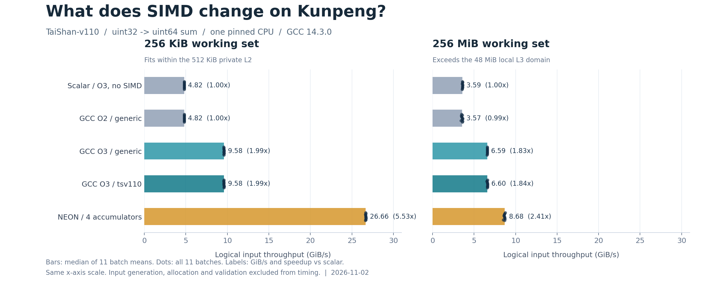

# 鲲鹏服务器 GCC / NEON 求和优化实测

[返回合集目录](../README.md)

**[技术博客](blog.md)** · **[完整结果表](measurements/table.md)** · **[官方参考资料](sources.md)** · **[公开版处理说明](PUBLICATION.md)**

2026-11-02 在真实 HiSilicon TaiShan-v110 服务器上完成的单核整数求和实验。对比 O3 标量、O2/O3 自动向量化、`-mtune=tsv110` 与四路 NEON 累加。

| 工作集 | O3 标量 | O3 自动向量化 | NEON 四路累加 | NEON / 标量加速比 |
|---|---:|---:|---:|---:|
| 256 KiB | 4.82 GiB/s | 9.58 GiB/s | 26.66 GiB/s | 5.53× |
| 256 MiB | 3.59 GiB/s | 6.59 GiB/s | 8.68 GiB/s | 2.41× |

这里的吞吐为逻辑输入吞吐，小数组反复扫描可以命中缓存，不能将其直接当作 DRAM 带宽。各项结果为 11 个批次均值的中位数；全部 110 条批次记录均保留。完整计时范围、最小/最大值、适用边界见博客。



## 仓库内容

- `src/`：普通 C、NEON 实现，以及正确性与计时框架。
- `scripts/run.sh`：编译、汇编与向量化报告、独立 UBSan 检查、单核计时。
- `scripts/analyze.py`：从原始 CSV 重新计算结果，只使用 Python 标准库。
- `scripts/verify_artifacts.py`：校验实测源码 SHA-256、110 条批次记录、日志与博客结果表。
- `scripts/make_figure.py`：从实测结果生成 PNG，额外需要 Matplotlib。
- `measurements/`：原始计时、汇总、编译选项、五份汇编、正确性日志，以及脱敏后的环境和工具链记录。
- `blog.md`、`sources.md`、`assets/`：正文、官方参考资料与配图。

## 复核已保存结果

不需要鲲鹏服务器，在装有 Python 3 的 Windows、Linux 或 macOS 上运行：

```bash
git clone https://github.com/huskyhao/huawei-computing-practice.git
cd huawei-computing-practice/kunpeng-simd-sum-lab
python scripts/analyze.py
python scripts/verify_artifacts.py
```

15,480 项边界正确性比较全部通过；UBSan 额外覆盖框架、标量和手写 NEON 的插桩版本。三个自动编译版本在该检查中使用原优化对象文件。日志和具体方法见正文。

生成配图：

```bash
python scripts/make_figure.py
```

## 在 AArch64 Linux 重新实测

本次实测使用 NixOS 26.05、GCC 14.3.0、Python 3.12.10 和 `taskset`。请准备可识别 `-mtune=tsv110` 的 GCC，并将编译器和 Python 加入当前 shell 的 PATH；仓库不依赖任何机器专用 Nix store 路径。

先复制源码到新目录，保留已发布的结果：

```bash
mkdir -p ../kunpeng-simd-sum-rerun
cp -r src scripts ../kunpeng-simd-sum-rerun/
cd ../kunpeng-simd-sum-rerun
CPU=4 ROUNDS=11 TARGET_SECONDS=0.2 bash scripts/run.sh
```

脚本遇到已有 `measurements/raw.csv` 会停止，避免覆盖记录。先通过 `grep Cpus_allowed_list /proc/self/status` 检查允许的 CPU，必要时调整 `CPU`。运行使用单线程，最大数据工作集为 256 MiB。

源码和实测脚本保留原版本及原始校验值。重跑脚本会采集当前机器的原始环境日志；若要公开新的结果，请先按 [公开版处理说明](PUBLICATION.md)检查并脱敏。
