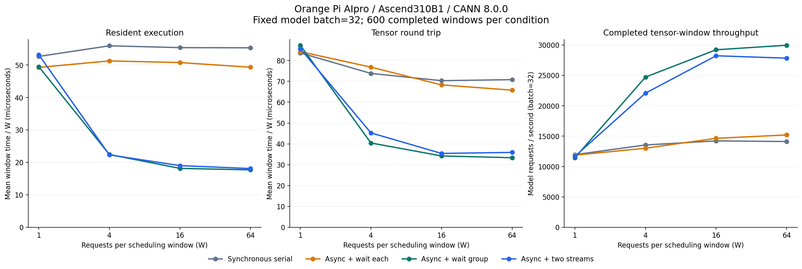
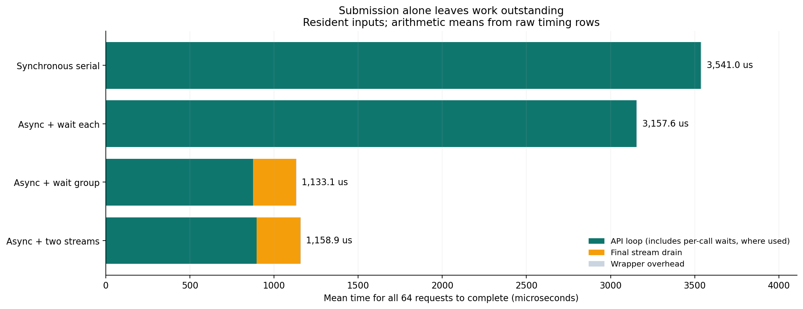

# 昇腾 pyACL 异步推理实测：等待频率与双 Stream 的收益边界

公开版说明：本实验作为合集中的独立目录维护，公开数值结果位于 `measurements/`。原始环境日志、PID、进程内模型 ID、完整诊断堆栈、模型二进制和逐样本数组保留在本地；配套脚本可在目标板重新生成完整材料。

**实验日期：2026 年 11 月 3 日。硬件：Orange Pi AIpro / Ascend310B1。工具链：CANN 8.0.0。**

前一次实践跑通了 ONNX 转 OM 和数字分类推理，这次把研究对象放到执行调度上：保持同一模型、同一份权重、相同输入和静态 batch=32，比较不同的等待方式。

实测发现，**减少每次推理后的同步等待，能明显提升这份小模型的连续处理速率；单纯增加 Stream 数量，收益并不确定。** 在包含输入复制、执行完成等待和输出读取的测试中，每组 64 次模型调用时，单 Stream 分组等待相对同步串行的处理速率约为 **2.12 倍**。四种策略在 360 个独立测试样本上均识别正确 352 个，准确率为 97.78%，输出 logits 与同步结果逐位一致。

此外，实验还复现了一条实用的运行时限制：本机这套 CANN 环境，在同一个模型 ID 上先同步执行、再切换异步执行，会返回 `500002`，内部信息为 `NnExecute not support mix execute`。采用独立模型实例后，四种策略都完成了正式测试。

## 一、实验问题：异步返回快，能代表结果完成得快吗

华为 AscendCL 提供同步执行接口 `acl.mdl.execute` 和异步执行接口 `acl.mdl.execute_async`。异步接口成功返回表示任务下发成功；读取输出前，还需要通过 `acl.rt.synchronize_stream` 等方式确认完成。官方文档同时要求，同一个模型 ID 应避免多 Stream 并发执行，模型的加载、执行与卸载保持在同一 Context。[execute_async 接口说明](https://www.hiascend.com/document/detail/zh/CANNCommunityEdition/80RC2alpha002/apiref/appdevgapi/aclpythondevg_01_0147.html)

因此，这次同时测量“提交循环”和“整个窗口完成”的耗时。正式性能比较始终以全部请求完成为边界。

四种策略如下：

| 策略 | 调用与等待方式 | 模型实例安排 |
| --- | --- | --- |
| 同步串行 | 每个请求调用 `execute`，完成后进入下一个请求 | 一个同步专用实例 |
| 异步逐次等待 | 每次 `execute_async` 后立即 `synchronize_stream` | 一个异步实例，一个 Stream |
| 单 Stream 分组等待 | 在同一个 Stream 连续提交 W 次，最后等待一次 | 与上一策略使用相同异步实例及 Stream |
| 双 Stream 分组等待 | 按请求序号轮流提交到两个 Stream，最后分别等待 | 每个 Stream 独享一个异步模型实例 |

三个模型实例加载的是同一个 OM 文件。同步实例和两个异步实例在全部策略的测量期间都保持常驻，加载和初始化不计入性能数据。

## 二、把模型 batch 和请求窗口分开

本实验使用 `64 → 128 → ReLU → 10` 的手写数字分类 MLP。它来自前一次已验证的实验，今天直接复制 OM 与测试输入到新目录，固定模型条件后研究新的调度变量。

| 参数 | 本次设置 |
| --- | --- |
| 模型静态 batch | 始终为 32 |
| 单次输入 | FP32，`[32,64]`，8192 字节 |
| 单次输出 | FP32，`[32,10]`，1280 字节 |
| 调度窗口 W | 1、4、16、64 次模型调用 |
| W=64 的数据量 | 64 次调用，每次 32 个样本，共 2048 个样本位置 |
| Python / NumPy | 3.10.12 / 1.24.0 |
| 运行模式 | `ACL_DEVICE`，板端运行 |
| CPU | aarch64，4 个逻辑 CPU |

W 只改变一次等待前组织多少次调用，没有修改模型的静态输入形状，也没有重新编译成 batch=2048。性能测量使用 360 条测试输入按既定顺序循环组成窗口，其中包含重复输入；独立准确率验证始终使用原来的 360 条样本。

本次使用的 OM SHA256 为：

```text
2004eec2746d88a02a49d76cc8a3c24a1c9017b80b55d5e8720d46e0e8637061
```

板端沿用已有虚拟环境，没有为此实验安装或升级系统软件。实验前后仍存在 `80E3A203` 电流获取异常告警，温度由约 50℃ 变为约 51℃，正式推理与结果核对均完成。功耗栏的 `0.0 W` 未用于任何能耗分析。测试在运行桌面的非独占设备上进行，下面的数字对应这次具体环境。

## 三、首先遇到的问题：同一模型 ID 混用执行模式

初版程序让同一个模型先执行同步正确性验证，再运行异步策略。第一个异步调用返回：

```text
execute_async: ACL error 500002
```

这个返回码本身不足以判断具体原因。我缩减为“单模型、一个输入输出槽、一次推理”，分别测试默认和显式 Stream，并通过 `acl.get_recent_err_msg()` 获取内部信息。

| 最小复现条件 | 同步返回码 | 异步返回码 | 观察结果 |
| --- | ---: | ---: | --- |
| 新模型直接异步，显式 Stream | 未调用 | 0 | 同步等待成功，输出为有限数值 |
| 新模型直接异步，默认 Stream | 未调用 | 0 | 同步等待成功，输出为有限数值 |
| 同一模型先同步、再异步，显式 Stream | 0 | 500002 | `NnExecute not support mix execute` |
| 同一模型先同步、再异步，默认 Stream | 0 | 500002 | 同样的内部错误 |

这组对照表明，在本机这套工具链与模型上，错误与同一实例混用执行模式相关，单独的异步路径能够工作。这里报告的是实机观察，适用范围限定为本次环境。

修正时明确分配角色：

```python
sync_id = models[0]          # 只调用 execute
async_ids = models[1:3]     # 分别绑定两个异步 Stream
```

全部模型的加载、执行、卸载保持在同一 Context。最小复现程序保存为 `scripts/probe_async.py`；四次探测的脱敏结果在公开目录 `measurements/probe-summary.json` 中；原始诊断日志保留在本地。

## 四、异步执行时，输入输出内存必须活到任务完成

异步场景还有一个容易影响正确性的细节：连续提交多次调用后，前一个任务可能尚未使用输入，或者尚未写完输出。若过早复用同一块内存，可能读到被覆盖的数据。

本次为最大窗口预先申请 64 个独立请求槽。每个槽包含自己的输入/输出 dataset、data buffer 和 Device 内存，总输入输出内存为：

```text
64 × (8192 + 1280) = 606208 字节 = 592 KiB
```

这只是显式输入输出槽的大小，模型内部工作区和运行时占用不包含在内。所有策略使用同一个槽池，申请与释放在计时之外完成。窗口内各槽装入不同位置的测试输入；整个窗口完成后再读取输出和复用内存。

单 Stream 分组策略的核心逻辑为：

```python
for i in range(window):
    slot = slots[i]
    check(acl.mdl.execute_async(
        async_ids[0], slot.inputs, slot.outputs, streams[0]
    ), "execute_async")

check(acl.rt.synchronize_stream(streams[0]), "synchronize_stream")
# 此时才读取所有 slot 的输出。
```

双 Stream 策略把请求分配给两个独立模型实例：

```python
for i in range(window):
    lane = i % 2
    slot = slots[i]
    check(acl.mdl.execute_async(
        async_ids[lane], slot.inputs, slot.outputs, streams[lane]
    ), "execute_async")

for lane in range(min(window, 2)):
    check(acl.rt.synchronize_stream(streams[lane]), "synchronize_stream")
```

Stream 内的提交顺序与同步等待方式参考官方 [模型执行流程](https://www.hiascend.com/doc_center/source/zh/canncommercial/900/programug/acldevg/aclpythondevg_0032.html) 和 [Stream 管理说明](https://www.hiascend.com/doc_center/source/zh/CANNCommunityEdition/800alpha002/devguide/appdevg/aclpythondevg/CANN%E7%A4%BE%E5%8C%BA%E7%89%88%208.0.0.alpha002%20AscendCL%E5%BA%94%E7%94%A8%E8%BD%AF%E4%BB%B6%E5%BC%80%E5%8F%91%E6%8C%87%E5%8D%97%28Python%29%2001.pdf)。本文代码在实际安装的 CANN 8.0.0 上验证。

## 五、先验证四种策略输出一致

将 360 个独立测试样本组织成 12 次静态 batch=32 的调用，最后一个批次补零。四种执行策略分别完成全部调用，统计时只保留有效的 360 行。

| 策略 | 正确数 / 独立测试样本 | 准确率 | 与同步结果的 logits 最大差异 |
| --- | --- | ---: | ---: |
| 同步串行 | 352 / 360 | 97.78% | 0 |
| 异步逐次等待 | 352 / 360 | 97.78% | 0 |
| 单 Stream 分组等待 | 352 / 360 | 97.78% | 0 |
| 双 Stream 分组等待 | 352 / 360 | 97.78% | 0 |

四种策略的完整 logits 数组逐位一致，且预测类别与 NumPy FP32 基线的一致率均为 100%。因此，这次调整执行策略没有改变本测试集的推理结果。

每个性能场景执行完一轮后，还会读取相应请求槽的输出，核对其预测类别与各自输入对应的 CPU 参考是否一致。该检查放在计时之外。

## 六、计时范围和测量次数

本次有两种计时范围：

1. **驻留输入执行窗口（resident）**：输入已写入 Device、输出缓冲区已分配，测量执行调用和等待全部完成的时间，输出读取在测量之外。
2. **张量往返窗口（tensor roundtrip）**：从内存中的输入数组开始，包含全部输入的 `tobytes` 与复制、执行和完成等待、全部输出的读取与 NumPy 数组构造。

张量往返的操作顺序统一为“先写入该窗口全部输入 → 执行对应调度策略并等待完成 → 读取全部输出”。输入使用同步复制，没有测试异步 memcpy 流水线。由于应用在 `ACL_DEVICE` 模式下运行，这些复制发生在板端，结果不包含跨 PCIe 的 Host/Device 传输成本。

两种范围都排除了模型加载、内存槽初始化、训练、ATC 转换、输入文件读取、图像解码、归一化、分类 argmax、网络服务和请求到达过程。

每个场景每轮预热 20 个窗口，再记录 200 个窗口，重复 3 轮。每轮使用固定随机种子打乱 32 个场景的执行顺序。正式数据共计：

```text
4 种策略 × 4 个 W × 2 种范围 × 3 轮 × 200 个窗口
= 19200 个已完成窗口
```

这些窗口包含 408000 次模型调用，性能测量重复使用既定输入。公开数值记录为 `measurements/formal_windows.csv`；每个场景有 600 个窗口样本。目标板重跑时，完整输出写入 `results/`。

## 七、包含输入输出处理后的结果

下表单位均为 **μs/窗口**，每个单元格依次给出“中位数 / P95”。一个窗口包含 W 次模型调用。

| 请求窗口 W | 同步串行 | 异步逐次等待 | 单 Stream 分组等待 | 双 Stream 分组等待 |
| --- | ---: | ---: | ---: | ---: |
| 1 | 87.81 / 100.24 | 85.70 / 99.74 | 88.04 / 106.19 | 82.78 / 101.33 |
| 4 | 284.81 / 343.21 | 301.56 / 355.56 | 156.63 / 186.36 | 165.17 / 220.23 |
| 16 | 1109.92 / 1266.51 | 1082.87 / 1168.79 | 543.38 / 569.12 | 553.30 / 642.67 |
| 64 | 4481.68 / 5010.16 | 4171.50 / 4423.98 | 2120.52 / 2214.44 | 2212.64 / 2589.19 |

当 W=1 时，几种策略的调用耗时接近，异步接口本身没有带来稳定、明显的优势。

当 W 增大后，单 Stream 分组等待和双 Stream 分组等待均明显优于逐次等待。W=64 时，单 Stream 分组的平均窗口耗时为 **2.135 ms**，同步串行为 **4.532 ms**；按平均完成时间换算，处理速率比值约为 **2.12 倍**。

换算速率的公式为：

```text
模型调用次数/秒 = W × 1,000,000 / 平均窗口耗时(μs)
```

| W | 同步串行，次/秒 | 异步逐次等待，次/秒 | 单 Stream 分组，次/秒 | 双 Stream 分组，次/秒 |
| --- | ---: | ---: | ---: | ---: |
| 1 | 11962 | 11874 | 11455 | 11677 |
| 4 | 13553 | 13021 | 24733 | 22088 |
| 16 | 14225 | 14647 | 29225 | 28238 |
| 64 | 14123 | 15206 | 29974 | 27842 |

每次模型调用内部处理 32 个样本。上表按“模型调用次数”计数，反映这段内存张量调用循环的处理速率；实际服务吞吐还需要计入输入组织、预处理、后处理与网络等待。

## 八、排除输入输出后，收益来自哪里

驻留输入执行窗口的中位数 / P95 如下，单位仍为 **μs/窗口**。

| 请求窗口 W | 同步串行 | 异步逐次等待 | 单 Stream 分组等待 | 双 Stream 分组等待 |
| --- | ---: | ---: | ---: | ---: |
| 1 | 55.85 / 68.61 | 54.28 / 62.27 | 53.96 / 63.63 | 56.02 / 70.42 |
| 4 | 218.50 / 264.07 | 200.90 / 237.70 | 84.25 / 119.69 | 87.38 / 92.43 |
| 16 | 875.49 / 1036.45 | 780.54 / 923.75 | 287.10 / 304.44 | 297.58 / 368.83 |
| 64 | 3548.20 / 4038.26 | 3139.17 / 3339.91 | 1123.24 / 1202.54 | 1148.68 / 1231.89 |

W=64 时，单 Stream 分组策略的完成速率约为同步串行的 **3.12 倍**。异步逐次等待与单 Stream 分组策略使用相同的异步模型实例和 Stream，它们的主要差异就是调用 `synchronize_stream` 的频率。

这组对照支持一个针对本案例的判断：对计算量很小的网络，减少逐次同步等待有实际收益。纳入输入复制与输出读取后，收益会被这些额外工作摊薄。



图中前两幅是“平均窗口耗时除以 W”的摊销值，第三幅是按平均张量往返窗口耗时换算的模型调用次数/秒。

## 九、提交结束与完成结束，差多少

异步提交的计时应与最后的等待一起看。以下数据来自驻留输入场景：

| 策略与 W | 提交循环中位数 | 组末等待中位数 | 整个执行窗口中位数 |
| --- | ---: | ---: | ---: |
| 单 Stream，W=1 | 14.50 μs | 38.05 μs | 53.96 μs |
| 单 Stream，W=64 | 867.67 μs | 252.96 μs | 1123.24 μs |
| 双 Stream，W=64 | 888.27 μs | 256.60 μs | 1148.68 μs |

这几列分别计算中位数，不能要求它们严格相加；整个窗口还包含少量 Python 调用与计时封装开销。这里的“提交循环”计入所有 API 调用及调度开销，运行时也可能在提交过程中产生背压，未将它解释为纯硬件执行时间。

W=64 的单 Stream 场景中，提交循环结束之后仍有约四分之一毫秒的组末等待。只报告提交时间，会漏掉这段完成等待。

下图改用原始记录的算术平均值画出组成部分，整体与平均窗口时间相符。同步串行和异步逐次等待的等待发生在 API 循环内部，因此对应绿色部分；只有分组策略具有显式组末等待。



## 十、双 Stream 为什么没有继续提速

W=64 时，双 Stream 的张量往返速率比单 Stream 分组策略低约 **7.1%**。在本次测试的 W=4、16、64 中，双 Stream 的张量往返平均耗时也都高于单 Stream 分组等待。

这个结果说明，在当前小型 MLP、单线程 Python 提交、Ascend310B1 和 CANN 8.0.0 的组合下，增加 Stream 数量没有继续提高这段处理流程的速率。

本次没有采集硬件执行轨迹，因此不进一步断言 AI Core 的重叠率、内部锁或具体算子调度行为。多 Stream 为运行时提供了调度机会，最终收益仍取决于具体模型和调用方式，需要测量完成时间来判断。

## 十一、摊销时间与在线请求延迟如何区分

W=64 时，单 Stream 张量往返平均窗口耗时约为 2.135 ms，除以 64 后约为 **33.36 μs/次调用**。这个数字表示把一组已完成工作的总成本摊到每次调用。

本程序统一等整个窗口完成后再读取输出，所以单个请求对外可用的时间还受整个窗口完成时刻约束。若真实业务还需要等待凑齐 W 个请求，则应额外测量凑组等待和完整响应延迟。本实验没有模拟请求到达过程。

因此，选择 W 时应同时考虑连续处理能力和结果返回时机。对这份模型，W=16 到 W=64 的单 Stream 张量处理速率增益已经收窄，而窗口整体耗时继续增加。

## 十二、复现步骤与文件说明

本次板端目录是：

```text
~/hw/ascend310b-async-streams-20261103
```

公开版在合集子目录中使用独立虚拟环境。已有实验环境也可通过 `BASELINE_DIR` 和 `EXPERIMENT_VENV` 显式复用；同板原始流程记录如下：

```bash
ssh OrangePi
cd ~/hw/ascend310b-async-streams-20261103
bash scripts/prepare_baseline.sh
bash scripts/collect_env.sh
EXPERIMENT_VENV="${HOME}/hw/ascend310b-digits-onnx-om/.venv" bash scripts/run.sh --warmup 20 --repeats 200 --rounds 3 --out-stem formal
```

最小错误复现需要先加载 CANN 与虚拟环境，然后运行：

```bash
python scripts/probe_async.py                 # 新实例直接异步
python scripts/probe_async.py --sync-first    # 同一实例先同步再异步
```

如果没有前次环境，配套工程也保留了完整的依赖安装、训练导出与重新转换脚本：

```bash
bash scripts/setup.sh
bash scripts/rebuild_model.sh
EXPERIMENT_VENV="$PWD/.venv" bash scripts/run.sh \
  --warmup 20 --repeats 200 --rounds 3 --out-stem formal
```

新设备应按自身 SoC 重新转换 OM。实验脚本当前针对已验证的板端 `ACL_DEVICE` 模式；其他运行模式需要相应调整内存复制与输出读取代码。

实验重跑后完整目录如下；公开仓库的 `measurements/` 提供脱敏汇总、原始数值计时与精简诊断结果，`models/`、`results/`、`logs/` 在目标设备生成：

```text
report.md                          本报告，可作为技术博客正文
scripts/async_experiment.py         四种策略、正确性验证、正式计时
scripts/probe_async.py              执行模式混用的最小复现
scripts/analyze_results.py          原始数据交叉核对和绘图
scripts/write_report.py             由实测 JSON 生成报告
models/                            固定模型、权重和测试输入副本
results/formal.json                32 个场景的汇总
results/formal_windows.csv         19200 条完成窗口记录
results/validation_*.npz           四种策略的逐样本输出
results/probe-summary.json         四个最小探测的结果与错误信息
results/verification.json          本地材料核对结果
logs/                              环境、正式运行与诊断日志
assets/                            两张基于真实数据绘制的图片
```

回收结果后，在装有 NumPy 和 Matplotlib 的电脑上运行 `python scripts/analyze_results.py`，即可重新计算统计、验证输出数组与文件哈希并生成配图；`python scripts/write_report.py` 会根据汇总数据更新本文。

这次实验把“异步 API 调用”“任务完成”“输入输出内存生命周期”和“多 Stream 实际收益”放在同一个可核对的流程里。对当前小型分类网络，先减少逐次等待已经获得明显收益；同时，独立模型实例和正确的完成等待，是实现可用异步推理的必要工程细节。

**关键词：** 华为昇腾、CANN、AscendCL、pyACL、Orange Pi AIpro、异步推理、Stream、同步等待、性能测试。
