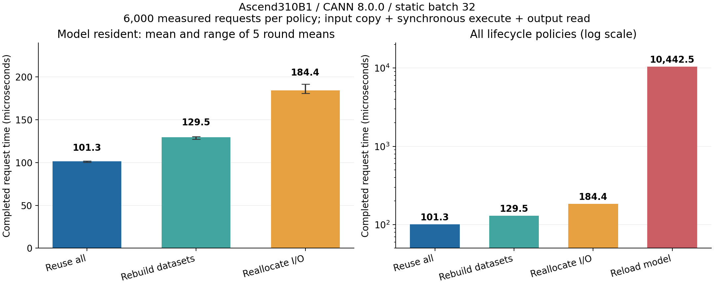
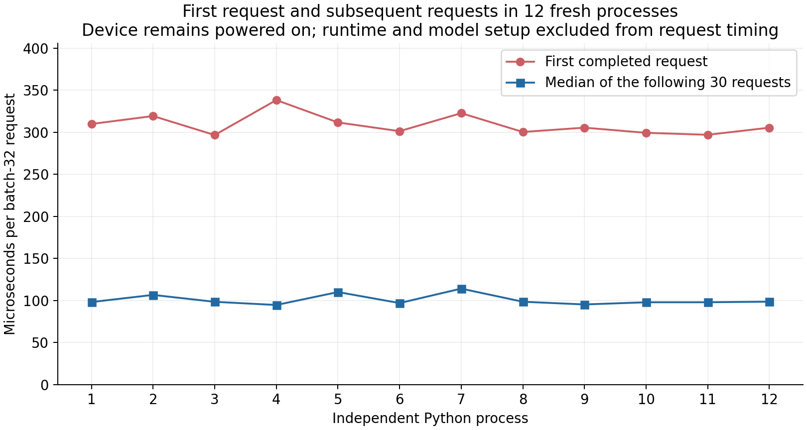

# 昇腾 310B 实测：一次推理 0.10 毫秒，为什么写进循环后会变成 10 毫秒？

在 Orange Pi AIpro 上跑通 ONNX 转 OM 和 pyACL 推理之后，我想继续回答一个工程问题：**同一个模型连续处理输入时，模型、Dataset 和输入输出内存分别值得复用到什么程度？**

这次通过 SSH 在实机上做了四种资源生命周期对照，共保存 **24,000 条正式请求计时**，再用 **12 个独立 Python 进程**观察初始化和首轮推理。

固定 batch=32 的同一个小型数字分类模型，全部复用时平均 **0.101 毫秒/次**；每次重新加载并卸载模型时平均 **10.443 毫秒/次**，两者相差约 **103 倍**。这个差距说明小模型调用容易被生命周期管理淹没；它不是模型算子本身加速了 103 倍。

## 1. 固定模型，只改变资源的存活时间

本次继续使用已经验证过的 `64→128→10` 手写数字 MLP：输入来自 `sklearn.datasets.load_digits`，8×8 灰度值除以 16，训练集 1,437 条，独立测试集 360 条。沿用相同权重、静态 batch=32 的 OM 和测试输入，不重新训练，不改变精度策略，也不加入异步执行。

| 项目 | 实际环境 |
| --- | --- |
| 开发板 / NPU | Orange Pi AIpro / `Ascend310B1` |
| CPU / 内存 | aarch64，4 个逻辑 CPU，约 23 GiB |
| 系统 / 内核 | Ubuntu 22.04.3 LTS / Linux 5.10.0+ |
| CANN / 驱动工具 | CANN 8.0.0 / npu-smi 23.0.0 |
| Python / NumPy | 3.10.12 / 1.24.0，沿用独立虚拟环境 |
| 运行模式 | `ACL_DEVICE=0`，程序运行在集成开发板上 |
| 模型输入 / 输出 | `[32,64]` FP32 / `[32,10]` FP32 |
| 输入 / 输出字节数 | 8,192 / 1,280 |
| 执行接口 | 同步 `acl.mdl.execute` |

两块 I/O 缓冲区的申请大小合计 **9,472 字节**。这只是显式 I/O 申请量，不包括分配器对齐、模型权值、工作内存与运行时资源。

模型 SHA-256：

```text
2004eec2746d88a02a49d76cc8a3c24a1c9017b80b55d5e8720d46e0e8637061
```

测试输入文件 SHA-256：

```text
c3ddfc42846a516789b294426374d5dbfed3d8ed6e4b50f8a190657197414165
```

实验前后 NPU 温度分别为 48℃、49℃，AICore 利用率采样为 0%。设备始终带有既存告警 `80E3A203`，信息为电流获取异常；本文保留这一环境限制，不根据 0.0W 读数计算能耗。系统 load average 的一分钟值约 17.24～17.52，但前后 `vmstat` 的一秒间隔采样显示 CPU 空闲约 97%～98%，无 swap。这里仅报告观测，不对异常负载均值作根因判断。

## 2. Dataset、DataBuffer 与内存要分清

pyACL 中，Dataset 描述模型的输入或输出集合，DataBuffer 描述其中一块缓冲区的地址和长度，真正存放张量的是相应地址的内存。创建、销毁描述对象和申请、释放张量内存是可以分别安排的操作。[官方 create_dataset 说明](https://www.hiascend.com/doc_center/source/en/canncommercial/800/apiref/appdevgapi/aclpythondevg_01_0195.html)

`acl.mdl.load_from_file` 则把 OM 加载为可执行的模型实例，并由系统管理模型运行所需内存。[官方模型加载说明](https://www.hiascend.com/doc_center/source/zh/canncommercial/800/apiref/appdevgapi/aclpythondevg_01_0139.html)

因此我设计了四种嵌套的生命周期策略：

| 策略名 | 模型与模型描述 | I/O 内存 | Dataset 与 DataBuffer |
| --- | --- | --- | --- |
| `reuse_all` | 在测试块外创建，块结束后释放 | 复用 | 复用 |
| `recreate_dataset` | 复用 | 复用 | 每次创建和销毁 |
| `reallocate_io` | 复用 | 每次申请和释放 | 每次创建和销毁 |
| `reload_model` | 每次加载、查询并卸载 | 每次申请和释放 | 每次创建和销毁 |

四种策略共用已经初始化好的同一个 Context，串行执行；`reload_model` 并没有每次重启 Python 或重新调用 `acl.init()`。第一项针对模型常驻，第二项隔离描述对象的重建，第三项再加入真实内存管理，最后一项增加模型加载和卸载。

这也是为什么“复用内存”和“复用 Dataset”不应混为一个开关。官方 `acl.rt.malloc` 文档明确建议预分配或自行管理内存，避免频繁申请、释放；这个建议到底有多大影响，需要结合实际模型测量。[官方内存申请说明](https://www.hiascend.com/doc_center/source/zh/canncommercial/800/apiref/appdevgapi/aclpythondevg_01_0110.html)

## 3. 如何计时，如何保证没有把工作漏掉

每个“请求”是一次静态 batch=32 的模型调用。360 个测试样本被装成 12 批，最后一批补零，计时阶段循环使用这些批次。本文测的是持续提供已准备好张量时的调用开销，没有在线攒批的等待时间。

正式测试为 **5 轮 × 4 策略 × 每策略 1,200 次 = 24,000 次**，每种策略有 6,000 条计时。每轮每个策略先执行 20 次不计入统计的预热；每轮策略顺序由 `20261104 + 轮号` 为种子的随机数打乱。预热对于重新加载策略也会每次重新加载，不能把这种策略预热成常驻模型。

总计时从该次资源操作前开始，到输出已复制为独立数组、该次需要释放的资源也全部释放后结束：

```text
按策略准备模型 / 内存 / 描述对象
  → 输入复制
  → 同步 execute，等待结果
  → 读取输出并复制为独立 NumPy 数组
  → 按策略销毁描述对象 / 释放内存 / 卸载模型
  → 停止总计时
  → 核对输出、写入 CSV
```

输入预处理、补零、`tobytes()`、磁盘读取、初始化 Context，以及每个测试块常驻资源的创建与最终释放均在正式请求计时外。输入指针转换、输入内存复制、输出读取和数组复制则计入请求时间。该计时范围也不包含网络、图片解码或应用接口层。

程序在 `ACL_DEVICE` 模式使用 `DEVICE_TO_DEVICE` 复制输入，并从本机可访问的输出指针读取结果。这里的“输入输出”不表示离散卡的 PCIe 往返。脚本遇到 `ACL_HOST` 会明确终止，避免把未经本实验验证的运行模式混进结果。

同步 `execute` 返回时已产生推理结果；完成后再读取、释放缓冲区符合本次串行调用的生命周期。[官方 execute 说明](https://www.hiascend.com/doc_center/source/zh/canncommercial/800/apiref/appdevgapi/aclpythondevg_01_0145.html)

逐阶段计时用于定位开销。`perf_counter_ns()` 连续两次调用的中位间隔约 **0.291 微秒**；闭包调用和记录阶段本身也有成本。下表是带这些观测代码的 Python 微基准，没有做计时开销扣除，也不应视为裸 C 接口或纯 AICore 计算耗时。

## 4. 正式结果：模型常驻之外，I/O 复用也有收益

单位均为 **微秒/次 batch=32 调用**。P95 按全部 6,000 条记录计算，保留慢样本，不做离群值删除；倍数以各策略均值除以全部复用的均值。

| 策略 | 均值 | 中位数 | P95 | 相对全部复用耗时 |
| --- | ---: | ---: | ---: | ---: |
| 全部复用 | 101.344 | 104.189 | 115.191 | 1.00 倍 |
| 每次重建 Dataset | 129.501 | 131.210 | 146.961 | 1.28 倍 |
| 每次申请 I/O 内存 | 184.399 | 183.961 | 208.463 | 1.82 倍 |
| 每次重新加载模型 | 10442.549 | 10424.793 | 10750.775 | 103.04 倍 |



左图把模型常驻的前三种策略放在同一线性坐标下，误差线表示五轮均值的最小值到最大值；右图使用对数坐标展示包含重新加载模型的全部策略。

单独重建描述对象，均值从 **101.344** 增至 **129.501 微秒**，增加约 **27.8%**；连同两块 I/O 内存一起重新申请、释放后，均值达到 **184.399 微秒**。从后者改成全部复用，所测平均请求时间下降约 **45.0%**。

最后一种策略平均 **10,442.549 微秒**，约为全部复用的 **103.04 倍**。这里包含反复加载后的首次执行及释放操作，不能把它理解成单独一个 `load_from_file` 调用耗时。

五轮结果也一并列出，避免结论依赖某一个短时间段：

| 轮次 | 全部复用 | 重建 Dataset | 申请 I/O 内存 | 重载模型 |
| --- | ---: | ---: | ---: | ---: |
| 1 | 101.696 | 130.504 | 183.172 | 10482.228 |
| 2 | 101.576 | 129.976 | 191.477 | 10402.504 |
| 3 | 101.807 | 129.946 | 183.201 | 10388.202 |
| 4 | 101.501 | 129.783 | 183.170 | 10489.390 |
| 5 | 100.142 | 127.297 | 180.976 | 10450.423 |

申请 I/O 内存策略的第二轮均值相对偏高，原始记录仍全部保留。没有通过挑选较快的一轮来构造倍数。

## 5. 时间花在哪里：拆解比猜测更有用

下表给出各阶段在 6,000 次请求中的平均耗时。0 表示该策略把这项操作放在请求计时之外。

| 阶段 | 全部复用 | 重建 Dataset | 申请 I/O 内存 | 重载模型 |
| --- | ---: | ---: | ---: | ---: |
| 加载模型、创建并查询模型描述 | 0.000 | 0.000 | 0.000 | 8927.336 |
| 申请两块 I/O 内存 | 0.000 | 0.000 | 19.301 | 31.699 |
| 创建 Dataset 与 DataBuffer | 0.000 | 11.294 | 10.528 | 21.514 |
| 输入指针转换与内存复制 | 11.468 | 11.130 | 9.939 | 16.799 |
| 同步 execute | 66.265 | 69.462 | 75.919 | 211.744 |
| 读取输出并生成独立 NumPy 数组 | 17.335 | 18.476 | 20.129 | 59.480 |
| 销毁 Dataset 与 DataBuffer | 0.000 | 9.931 | 10.416 | 20.350 |
| 释放两块 I/O 内存 | 0.000 | 0.000 | 26.128 | 44.395 |
| 销毁模型描述与卸载模型 | 0.000 | 0.000 | 0.000 | 1070.119 |
| 阶段之间的 Python 调度与计时记录 | 6.276 | 9.207 | 12.039 | 39.114 |

全部复用时，同步执行阶段平均约 **66.265 微秒**，请求总耗时约 **101.344 微秒**。即便模型和内存都常驻，输入复制、输出构造及 Python 调用依然占有可见比例。

在重新加载策略中，模型准备阶段平均约 **8.927 毫秒**，模型描述销毁与卸载阶段平均约 **1.070 毫秒**。二者已经占据大部分总时间，因此应先把模型生命周期移到连续处理循环外。

重载模型后的 `execute` 平均约 **211.744 微秒**，高于常驻情况下的约 **66.265 微秒**。这提示不同资源状态还会影响后续执行阶段；本文没有硬件 trace，不能仅凭阶段相减把全部差异归因于某一层缓存、分配器或某一条底层指令。阶段值也包含相应 Python 包装代码。

## 6. 12 个独立进程：初始化、首轮与后续调用要分别报告

进一步每次启动一个新 Python 进程，加载同一个输入文件，执行一次完整初始化与资源准备，再测第一批和后续 30 批，最后释放资源并退出。各进程之间不重启设备，不清理操作系统页缓存。

| 指标 | 12 个进程的中位数 |
| --- | ---: |
| `acl.init`、设置设备、创建 Context 与模式检查合计 | 1,009.954 毫秒 |
| 模型加载、描述查询、I/O 内存和 Dataset 准备合计 | 157.869 毫秒 |
| 资源准备完成后的第一批请求 | 305.421 微秒 |
| 后续 30 批各自中位数，再对 12 个进程取中位数 | 98.351 微秒 |
| 父进程测得启动到退出的完整墙钟时间 | 4,865.891 毫秒 |



这组数据呈现了三个量级：Runtime 初始化约 1 秒，资源准备约 158 毫秒，资源准备后的稳态调用约 0.1 毫秒。首批调用在 12 个进程中均比后续调用慢。

父进程的完整墙钟时间还包含启动、模块导入、输入文件加载、31 批请求、释放与退出等开销，不能作为“首次结果返回时间”。这组实验测的是新进程，不代表设备断电后的冷启动；初始化后的重复模型加载与新进程第一次加载也不是相同状态。

如果服务关注首次响应，可以把 Runtime 初始化、模型加载、缓冲区准备和业务允许的预热放在接收请求之前，并分别记录准备阶段与请求阶段。是否采用常驻进程，还应结合资源预算和实际服务生命周期决定。

## 7. 输出一致性：更快必须建立在同一结果上

四种策略都重新跑完 360 条独立测试样本，补零部分不计准确率：

| 策略 | 正确 / 总数 | 准确率 | 与 CPU 参考类别一致率 | 相对全部复用的最大 logit 绝对差 |
| --- | ---: | ---: | ---: | ---: |
| 全部复用 | 352 / 360 | 97.78% | 100% | 0 |
| 重建 Dataset | 352 / 360 | 97.78% | 100% | 0 |
| 申请 I/O 内存 | 352 / 360 | 97.78% | 100% | 0 |
| 重载模型 | 352 / 360 | 97.78% | 100% | 0 |

此外，24,000 次正式请求在计时结束后都检查有限数值，并与相同输入批次的基准输出逐元素精确比较，全部通过。独立进程测试也检查首批类别与 CPU 参考一致，并检查后续 30 批与首批输出精确一致。

这里的 97.78% 是固定模型在原测试划分上的结果，不是新训练带来的精度提升；性能样本是重复调用，不能当成新增独立测试样本。

## 8. 把资源准备移出循环，落到代码里

完整实现见 [resource_lab.py](scripts/resource_lab.py)。核心结构可以写成下面这样：

```python
# 同一个已初始化的 Context；Model/Memory/Datasets 分别拥有自己的资源。
request = Request("reuse_all")
try:
    for payload in prepared_input_bytes:
        output, stages = request.run(payload)
        consume(output)  # output 是独立数组，可在下一轮覆盖设备缓冲区后继续使用
finally:
    request.close()
```

这个实验刻意将资源所有权分开：`Datasets.close()` 销毁描述对象，`Memory.close()` 释放底层 I/O 内存，`Model.close()` 销毁模型描述并卸载模型；顺序为描述对象、I/O 内存、模型，再处理 Context 与 Runtime。各 API 的错误码均检查。

上述代码适用于本文的串行同步路径。如果以后改成异步或并发处理，必须先等使用这些内存的任务完成，再覆盖或释放缓冲区；给每个在途请求提供独立或正确管理的 I/O 槽位，并遵守模型实例和 Context 的接口约束，不能直接照搬单槽位循环。

## 9. 复现步骤与证据文件

项目说明见 [README](README.md)。保存下来的计时数据不依赖昇腾环境，普通电脑上运行：

```bash
python scripts/analyze_results.py
```

该命令用 Python 标准库重算统计值，检查 24,000 条记录的唯一性、轮次、输入批次平衡、阶段合计、策略边界与已保存汇总是否一致；它不在普通电脑上重新运行 NPU。

在匹配的 Ascend310B1 / CANN 环境重跑，可先从同系列 ONNX→OM 实验准备相同文件，或者用本目录提供的脚本重建：

```bash
# 路径为本实验目录。先创建独立 Python 环境，再训练、导出和转换。
bash scripts/setup.sh
bash scripts/rebuild_model.sh

# 若已有兼容模型和输入，可用 prepare_inputs.sh 复制，替代上一步重建。
# BASELINE_DIR=/path/to/baseline bash scripts/prepare_inputs.sh

bash scripts/run.sh --label formal --rounds 5 --repeats 1200 --warmup 20
bash scripts/run.sh --startup --processes 12
python scripts/analyze_results.py --base results --write
```

模型重建会使用当前目标设备查得的 SoC；若训练库、CANN 或编译条件不同，应记录新的文件哈希，并把结果当作本机复现，不强求重新生成的二进制与本文逐字节相同。实验脚本不会安装或升级系统 CANN。

证据按用途分开保存：

- [正式逐请求计时](measurements/formal/requests.csv)：24,000 行，全部阶段和总计时。
- [配置与正确性检查结果](measurements/formal/metadata.json)：轮次、随机顺序、固定输入哈希及输出检查计数。
- [独立进程记录](measurements/startup/processes.csv)：12 个进程的阶段计时。
- [可重新计算的统计汇总](measurements/summary.json)与[环境摘要](measurements/environment.json)。
- [复核脚本](scripts/analyze_results.py)与[绘图脚本](scripts/make_figures.py)。

完整模型、原始输出数组和机器日志另外保留在本地实验目录。适合分享的目录只包含正文、复现代码、图片和去除机器身份信息的数值材料，详见 [公开材料说明](PUBLICATION.md)。

这次实践让我更明确了优化顺序：先让模型和 Context 在合适的服务生命周期内常驻，再复用 I/O 缓冲区和描述对象，最后用真实业务负载衡量后续优化。对这个很小的 MLP，减少资源管理足以显著改变调用时间；对更大的网络、不同 batch、不同 CANN 版本或 Host 模式，仍需重新测量。
